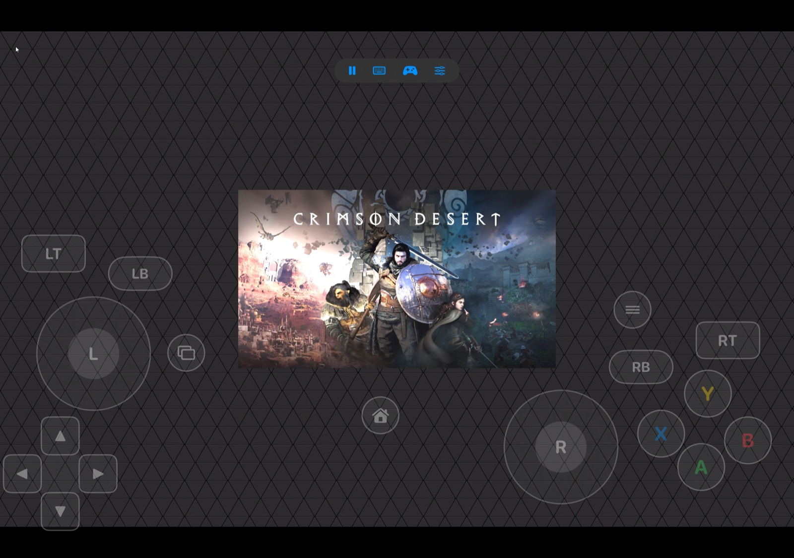

# GeForce Now Duo

GeForce Now Duo is a native GeForce NOW client for iPhone and iPad. It streams
your GeForce NOW library over WebRTC with a customizable on-screen gamepad, a
touch trackpad, gyro aiming, and a live keyboard, so you can play without a
browser or a physical controller.

It is a fork of [CloudNow](https://github.com/owenselles/CloudNow), the Apple TV
cloud gaming client by Owen Selles. GeForce Now Duo reuses CloudNow's GeForce NOW
account, catalog, session, and streaming code and adds an iOS target built for
touch screens.



> **Independent, unofficial client.** This project is not affiliated with,
> endorsed by, or sponsored by NVIDIA. NVIDIA and GeForce NOW are trademarks of
> NVIDIA Corporation. GeForce Now Duo is available only as a source build. It is
> not on the App Store or TestFlight.

## Features

### Library and sign-in

- Sign in with your NVIDIA account or a supported regional partner.
- Browse the GeForce NOW catalog and your cloud library, search, sort, filter,
  favorite games, and resume recent sessions.
- Layouts adapt to the window width. iPhone uses a tab bar; iPad gets a
  sidebar-adaptable tab bar and page-sized game sheets with a two-column layout.
- Sign-in works in any orientation. Streams lock to landscape.

### Touch controls

- A full on-screen gamepad: two sticks, D-pad, A/B/X/Y, bumpers, triggers, stick
  clicks, View, Menu, and Home.
- Edit the layout while streaming: drag and resize controls, add or delete
  them, snap to a grid, use floating sticks, or reset to the standard layout.
  Layouts are saved on the device.
- Touches that miss a control act as a laptop trackpad: drag to move the
  pointer, tap to left-click, two-finger tap to right-click, two-finger drag to
  scroll, and tap then hold to drag.
- Gyro aiming drives the mouse or the right stick, either always, while LT is
  held, or while touching the right stick.
- The keyboard button raises the system keyboard and sends each key to the
  stream as you type, with autocorrect and smart punctuation turned off.
- Touch controls hide automatically while a physical controller is connected.
  The control bar lets you show them anyway.

### Streaming

- Picks the stream resolution that best fits your screen the first time your
  account's resolutions load, so a phone gets a stream shaped like its display
  rather than a TV's 16:9. You can change it in Settings at any time.
- Supports H.264, H.265, and AV1, with 4:2:0 chroma by default.
- Runs at up to 120 Hz on ProMotion devices and holds the display at the
  stream's frame rate during play.
- Tuned for Wi-Fi: the app requests a bitrate floor and dynamic frame-rate
  control, waits briefly for ICE to recover before reconnecting, decodes H.265
  and AV1 asynchronously, and rebuilds the decoder after a malfunction instead
  of dropping the stream.
- Controller, keyboard, mouse, and touch input, with rumble and an optional
  microphone.
- Account-aware resolution, frame rate, codec, color, audio, language, maximum
  bitrate, Low Latency Mode (L4S), and server location settings.

### Diagnostics

- Compact or Standard statistics HUD. The Standard HUD adds a Device section:
  display refresh rate, thermal state, Low Power Mode, hardware or software
  decoding with reset and error counts, and NACK/PLI counts.
- An optional per-second stream health log (network, decoder, renderer,
  thermal, refresh rate) saved as CSV and shareable from Settings.

## Requirements

- iPhone or iPad running iOS 26.2 or later
- A GeForce NOW account
- Xcode with the iOS 26.2 SDK and an Apple ID for signing

## Building from source

1. Clone the repository and check out the `geforce-now-duo` branch:

   ```bash
   git clone -b geforce-now-duo https://github.com/Faizanabid1/CloudNow.git
   cd CloudNow
   ```

2. Copy `Local.xcconfig.example` to `Local.xcconfig` and set your Team ID.
3. Open `CloudNow.xcodeproj` and select the **CloudNowPhone** scheme.
4. Under **Signing & Capabilities**, choose your team. If Xcode reports that the
   bundle ID `dev.opennow.gfnduo` is taken, change it to one of your own.
5. Select your iPhone or iPad and run. The shared scheme builds in Release, which
   streams far more smoothly than a Debug build.

A free Apple ID works, but apps signed with it expire after 7 days and must be
reinstalled from Xcode.

## Repository layout

| Path | Contents |
|---|---|
| `CloudNowPhone/` | The iOS app: phone and iPad screens, stream touch controls, keyboard, resolution fitting, orientation lock, and the health log settings |
| `LocalPackages/VirtualControllerKit/` | The touch gamepad: layout, stick math, trackpad gestures, and gyro aiming (`VirtualControllerKit`), plus the SwiftUI overlay and editor (`VirtualControllerUI`) |
| `CloudNow/` | Shared GeForce NOW account, catalog, session, WebRTC, decoder, and input code from upstream CloudNow. iOS changes sit behind `#if os(iOS)` |
| `Scripts/make_phone_icon.swift` | Generates the app icon |

The upstream Apple TV app and its Xbox Cloud Gaming code are still in the
repository and still build for tvOS, unchanged. The iOS app compiles the Xbox
code but never activates it: GeForce NOW is the only service on iPhone and iPad.

## Testing

Run the touch controller unit tests from the repository root:

```bash
swift test --package-path LocalPackages/VirtualControllerKit
```

The shared CloudNow test plan (`Scripts/test.sh --full`) runs on a tvOS
simulator and covers the upstream code that both apps share. Streaming, touch,
gyro, and decoder behavior need a physical iPhone or iPad to verify.

## Linting

The shared code follows upstream CloudNow's SwiftLint and SwiftFormat setup.
Run both non-mutating checks before committing:

```bash
swiftformat --lint --config .swiftformat CloudNow CloudNowTests CloudNowUITests
swiftlint --strict --config .swiftlint.yml CloudNow CloudNowTests CloudNowUITests
```

CI and pre-commit hooks use these exact versions:

- SwiftFormat 0.62.1
- SwiftLint 0.65.0

## Known limitations

- GeForce NOW integration is unofficial. NVIDIA can change its APIs without
  notice.
- Delivered resolution, frame rate, HDR, and audio depend on your account,
  network, and device. Selecting a setting does not guarantee it.
- The Apple TV-specific Siri Remote input modes are hidden on iOS.

## Credits

- [CloudNow](https://github.com/owenselles/CloudNow) by Owen Selles, the
  upstream Apple TV client this app is built on. Consider
  [sponsoring its maintenance](https://github.com/sponsors/owenselles).
- [PrintedWaste](https://printedwaste.com) provides community GFN zone queue
  depths and region mapping.
- [livekit/webrtc-xcframework](https://github.com/livekit/webrtc-xcframework)
  provides WebRTC for Apple platforms.

## License

MIT. See [LICENSE](LICENSE).
